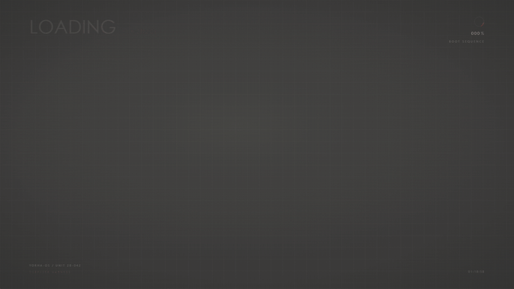
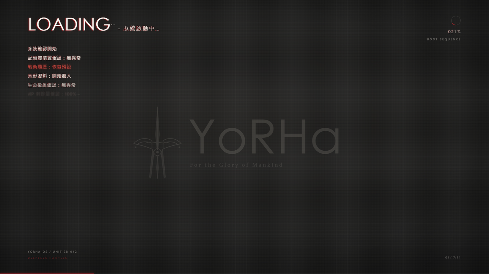
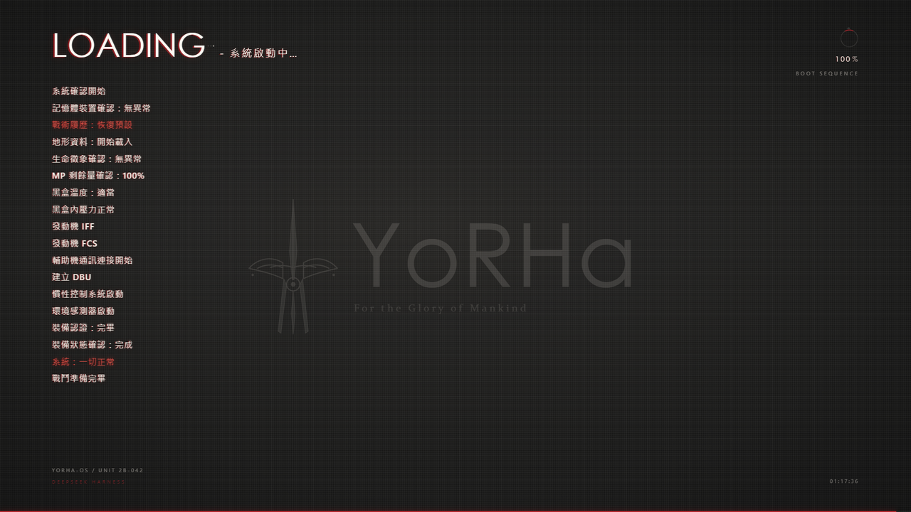
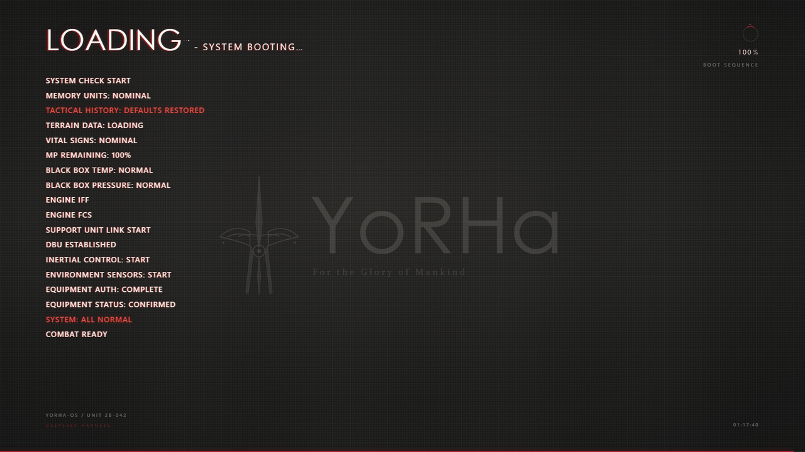

# dsh-nier-splash

> NieR:Automata / YoRHa 风格的 DeepSeek Harness 开机动画（boot splash）插件。



*(动图是 720p 抽帧，真实运行是全屏 60fps；静帧见 [docs/preview.png](docs/preview.png)。)*

动画本身不含视频、不含第三方素材：全部是 CSS + 一小段 SVG 与原生 JS，注入到 Harness 的 web 入口里，样式加脚本一共三十 KB 上下。

## 安装

这个仓库是一个完整的 DSH bundle 插件：`package.json` 里声明了 `dsh.bundle.patch`，仓库根有 `cordis.patch.yml`，不需要构建步骤。

**方式 A：插件页**

1. 打开 Harness → 设置 → 插件 → 添加插件
2. 选「本地路径」填 `D:\Desktop\dsh-Nier`（也可以先 `npm pack` 出 tgz 再装 tgz）
3. 装完 **完全退出 Harness**（Windows 右下角托盘图标 → 退出），再重新打开

**方式 B：命令行**

```powershell
dsh plugin --profile desktop add "D:\Desktop\dsh-Nier"
# 也可以直接给仓库地址
dsh plugin --profile desktop add "https://github.com/enlin0/dsh-Nier"
```

> Harness 运行时会锁住配置，装完不退出重启是不会生效的；单纯刷新页面也不行。

装好后每次启动 Harness 都会先播一遍。启动过程中页面若自己刷新一次，60 秒内不会重播（这个保护可用 `replayOnReload` 关掉）。

和别的开屏插件（例如 dsh-rhine-splash）同时启用时，只要对方的浮层先出现在页面上，本插件就自动让位、不挂载——不需要手动二选一，也不用担心谁压住谁。详见下面的「与其他开屏 / 主题插件共存」。

## 截图

| 启动中 | 自检完成 | 英文日志 |
| --- | --- | --- |
|  |  |  |

## 配置

在 插件页 → dsh-nier-splash → 配置 里改，或者直接编辑 `~/.dsh/profiles/desktop/cordis.patch.yml`（配置文件是 `cordis.yml`，但装饰层是 `cordis.patch.yml`，改后者才生效）。

| 键 | 默认值 | 说明 |
| --- | --- | --- |
| `enabled` | `true` | 关掉就完全不注入 |
| `duration` | `4500` | 最短显示时长（毫秒，2000–12000） |
| `maxWait` | `8000` | 等界面渲染的最长兜底时间（毫秒） |
| `exit` | `collapse` | 退场动画：`collapse` / `fade` / `glitch` |
| `lang` | `zh` | 自检日志语言：`zh`（繁体）/ `en` |
| `skippable` | `true` | 允许点击 / 按键跳过 |
| `replayOnReload` | `false` | 关掉"刚播过就别再播"的保护（默认保护 60 秒内的一次快速刷新） |
| `scanlines` | `true` | 是否画 CRT 扫描线 |
| `accent` | `#b3272d` | 强调色（LOADING 的红、warn 行） |
| `serial` | `YORHA-OS / UNIT 2B-042` | 左下角编号 |
| `captionPalette` | `auto` | 标题栏按钮配色：`auto` 时如果别的插件已经改过外壳配色就不覆盖；`on` 强制借用；`off` 完全不碰 |

### 与其他开屏 / 主题插件共存

本插件刻意排在后面，不抢别人的配置：

- 页面上已经存在别的开屏浮层（例如 dsh-rhine-splash，它的 `z-index` 更高）时，脚本直接不挂载，4.5 秒也不会在下面白播一遍。
- 标题栏那三个原生按钮的配色是借外壳的 CSS 变量实现的。默认 `auto`：只有当外壳配色还是系统中性的深灰时才借；已经被主题插件改成别的颜色（比如莱茵生命的青绿）就不动，播完也不会残留。
- 想强制用自己的深色配色，把 `captionPalette` 设成 `on`。

## 本地预览

不装插件也能看效果：直接用浏览器打开 `preview/index.html`（`file://` 即可），页面里模拟了一份 Harness 外壳。

支持用 query 覆盖参数，方便调：

```
preview/index.html?duration=6000&lang=en&exit=glitch
preview/index.html?replay=0        # 体验真实的“刷新不重播”保护
preview/index.html?debug=1         # 叠加 t / opacity / 行数 / 进度 的诊断条
preview/index.html?reduced=1       # 模拟 prefers-reduced-motion
preview/index.html?shell=theme     # 模拟主题插件已改过外壳配色（本插件应不覆盖）
preview/index.html?rival=1         # 模拟已有别的开屏浮层（本插件应让位、不挂载）
```

## 目录结构

```
lib/index.js        宿主侧插件：声明配置、把 css/js 注入 web 入口
lib/splash.css      动画样式（作用域全部在 #nier-splash 下）
lib/splash.js       浏览器侧：搭 DOM、打日志、等界面就绪、退场
cordis.patch.yml    让 Harness 把插件插进 bundle
screenshots.json    市场详情页截图清单
preview/index.html  独立预览页
icon.svg            插件图标（矢量）
assets/             市场用位图：图标 180/512、三张截图
docs/               README 用的静帧与动图
```

## 打包规范

按 [awesome-dsh-plugin](https://github.com/awesome-dsh-plugin/awesome-dsh-plugin) 的要求组织：

- `package.json` 声明 `dsh.bundle.patch` → `cordis.patch.yml`（装得上才谈得上收录；只写 `dsh.client` 不算）
- `cordis.patch.yml` 只做 `insert`，不写 `config`，避免把默认值复制成用户覆盖项
- 不声明任何 `@deepseek-ai/*` 依赖：schemastery 在运行时用 `try { await import(...) } catch {}` 动态获取，缺了照样跑，只是插件页没有配置表单（这样也不会因为 peer 范围排除 harness 的预发布构建而让人踩 ERESOLVE）
- `dependencies` 为空、没有构建步骤，从源码或 tgz 都能直接装
- 市场截图写在仓库自己的 `screenshots.json`，位图图标放 `assets/`
- MIT

投稿到 awesome-dsh-plugin 时，这个仓库对应的条目是 `data/plugins/enlin0__dsh-Nier.yml`：

```yaml
url: https://github.com/enlin0/dsh-Nier
name: enlin0/dsh-Nier
category: theme
description:
  en: 'NieR:Automata YoRHa style boot splash: a code-drawn CRT self-check log plays while the harness starts, then collapses like a CRT powering off.'
  zh: '《尼尔：机械纪元》YoRHa 风格开机动画：启动时播放一段由代码绘制的 CRT 自检日志，最后像 CRT 关机一样收束退场。'
icon: https://raw.githubusercontent.com/enlin0/dsh-Nier/main/assets/icon-180.png
```

另外仓库需要打上 `dsh-plugin` topic、并且创建满 1 天——这两条在 GitHub 那边设置，不在代码里。

## 素材说明

画面完全按 NieR:Automata 开机序列的手感重绘：日志文案、字标排版、网点与扫描线纹理都是照着参考视频逐帧比对出来的，但徽记是重新画的原创矢量，仓库里没有附带原视频，也没有素材文件。

## 许可

[MIT](LICENSE)
